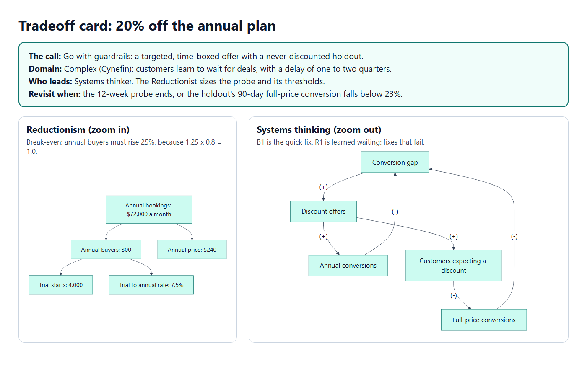
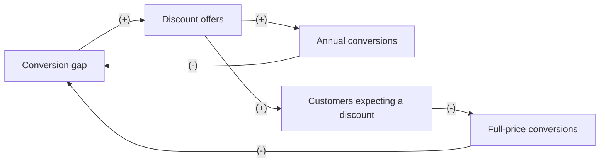

# Reductionism vs Systems Thinking

**Your metric is a tree. Your product is a loop. Good calls need both.**

A Claude plugin for product decisions. Two opposing lenses look at the same call on their own. The Reductionist zooms in: a metric tree, Fermi numbers, a break-even and the cleanest test. The Systems thinker zooms out: feedback loops, delays, who reacts and why. They argue once. Then a referee grounded in Cynefin decides which lens leads for this decision and makes exactly one call: Go, Go with guardrails, Redesign, Don't, or Get X first when one cheap fact would settle it.



## An example: 20% off the annual plan

A fictional bookkeeping app wants to lift conversion with 20% off its annual plan.

The Reductionist breaks annual bookings into trial starts, the trial to annual rate and the price. A 20% price cut means annual buyers must rise 25% just to break even, because 1.25 x 0.8 = 1.0. A clean A/B test can read that in about 8 weeks.

The Systems thinker draws the loops. The discount closes the conversion gap fast, a balancing loop. But customers who see a discount learn to wait for the next one, full-price conversion falls, the gap reopens, and the team discounts again: a reinforcing loop with a delay of one to two quarters. That is the classic archetype "fixes that fail", and an 8-week test cannot see it.



The referee places the decision in the Complex domain: customers react, the effect loops back with a delay, and the outcome lands after the test window. So the Systems thinker leads and the Reductionist sizes the probe. The call is **Go with guardrails**: a targeted, time-boxed offer, a holdout that never sees a discount, and a guardrail on 90-day full-price conversion. Measure the part, watch the loop.

The full card: [annual-discount.md](skills/practice/references/cases/annual-discount.md).

## How the referee decides

| Domain | Looks like in product | Who leads | How to act |
|---|---|---|---|
| Clear | A known fix with a known result: a broken link, a typo, a required legal notice | Known good practice | Sense, categorize, respond: just do it |
| Complicated | Parts you can separate and measure: a funnel step, page speed, an onboarding step | Reductionist | Sense, analyze, respond: size it, test it, ship it, with loop guardrails |
| Complex | People adapt and effects loop back with a delay: pricing, discounts, rewards, notifications | Systems thinker | Probe, sense, respond: small safe-to-fail probes with holdouts, sized by the Reductionist |
| Chaotic | Something is breaking now: an outage, a fraud wave, a payment failure | Whoever acts first | Act, sense, respond: stabilize, then run a full card |
| Confusion | You cannot tell yet, or the options or parts can be decided separately and land in different domains | Split | Break the decision into parts, place each, give each its own leader |

The referee places a decision with five tests (separability, feedback with delay, reactors, shared things, time horizon), and reversibility sets the step size: a change you can undo in a day ships in one step, while a change customers remember moves in small, time-boxed steps.

## Before the lenses: the gate

The full card is not always worth its cost, so three checks run first.

* **Frame check.** The need goes on the card in the requester's own words. Each option is tested against those words, and an option that misses them is marked off-need and never picked.
* **Input gate.** The card names the one fact that decides between the options. If nobody knows it and one question would find it out, the call is **Get X first**: a short card with the question, ready to send, and the threshold for each option.
* **Assumption share.** The referee says how many inputs are assumed and reruns the call across their range. If the call flips, it asks for the fact first, or sets a probe that measures it.
* **Lite mode.** A quick take is one pass with no lens agents: one number, one loop, one call.

These came from the first real use. The full method ran on a partner lead where nobody knew the partner's volume. The card looked precise but stood on stacked assumptions, its pick did not answer what the partner had asked for, and one qualifying question would have reached the same next step.

## Gallery

| Case | Domain | Who leads |
|---|---|---|
| [20% off the annual plan](skills/practice/references/cases/annual-discount.md) | Complex | Systems thinker |
| [Cut onboarding from 5 steps to 3](skills/practice/references/cases/onboarding-steps.md) | Complicated | Reductionist |
| [Double the referral reward](skills/practice/references/cases/referral-reward.md) | Complex | Systems thinker |
| [A chatbot to deflect support tickets](skills/practice/references/cases/support-chatbot.md) | Complex | Systems thinker |
| [A daily push notification](skills/practice/references/cases/daily-push.md) | Complex | Systems thinker |
| [Raise the marketplace take rate](skills/practice/references/cases/take-rate.md) | Complex | Systems thinker |
| [Rewrite the pricing page button](skills/practice/references/cases/cta-copy.md) | Complicated | Reductionist |
| [Match a rival's feature list](skills/practice/references/cases/feature-parity.md) | Complex | Systems thinker |
| [A partner asks for two-way text reminders](skills/practice/references/cases/partner-lead.md) | Not placed: stopped at the gate | Nobody yet: get the volume first |

## Install

**claude.ai and Cowork:** once the plugin is listed in Claude's plugin directory, add it from Customize > Plugins. Until then, add this GitHub repository (`ardaasaroglu/reductionism-vs-systems-thinking`) as a marketplace in plugin settings and install the plugin from it.

**Claude Code:**

```
claude plugin marketplace add ardaasaroglu/reductionism-vs-systems-thinking
claude plugin install reductionism-vs-systems-thinking@reductionism-vs-systems-thinking
```

Then run `/reductionism-vs-systems-thinking:decide` with your decision, or just ask whether you should make a product change and the skill starts on its own.

## What runs where

* **Claude Code and Cowork:** the two lens agents run in parallel, each with only Read, Grep and Glob. Neither sees the other's answer before the clash.
* **claude.ai chat:** the lenses run one after another in the same conversation, and the Systems thinker works as if it had not seen the Reductionist's conclusion.
* **Quick takes:** ask for a quick take, or pass `--lite`, for one pass with no lens agents.

In every case the gate, the clash and the referee run in the main conversation, and the reply is one tradeoff card.

## Example prompts

* `/reductionism-vs-systems-thinking:decide Should we give 20% off the annual plan to lift conversion? 4,000 trials a month, 7.5% buy annual at $240.`
* `Should we send a daily reminder notification to users who have not opened the app in 3 days?`
* `We want to raise the Pro plan from $12 to $15 a month. What happens now and in two quarters?`
* `Should we double the referral reward? Think about second-order effects.`
* `Our support queue keeps growing. Should we add a chatbot or hire two more agents?`
* `A partner wants our app under their brand. Options: white-label it, build them a custom app, or license our API. Which one?`
* `Quick take: should we add dark mode? Users ask for it every week.`

## Practice mode

`/reductionism-vs-systems-thinking:practice` gives you a case without the answer. You write your reasoning, a Cynefin domain, who leads and one call. It grades you on the Gate (0 to 3) and on Reductionism, Systems thinking and Referee (0 to 4 each), with specific feedback, then shows the worked card. Bring your own decision to practice on it instead.

## Approaches we are considering

Ranked for the AI era by how often product people face the decision and how much a wrong call costs.

| # | Pair | The question it settles | Status |
|---|---|---|---|
| 0 | Reductionism vs Systems thinking (referee: Cynefin) | What happens if we make this change, now and later | Shipped 0.1.0 |
| 1 | Autonomy vs Oversight | Should the AI act alone or ask first | Planned |
| 2 | Deterministic vs Probabilistic | Rules and code, or a model, for this step | Planned |
| 3 | Unit economics vs Growth | Every AI answer costs money: does growth make or lose money at scale | Planned |
| 4 | Scaffolding vs the Bitter Lesson | Build workarounds for today's model, or wait for the next one | Planned |
| 5 | Centaur vs Cyborg | Split work between people and AI, or blend AI into every step | Planned |
| 6 | Inside view vs Outside view | Will it hit the target, and when | Planned |
| 7 | First principles vs Analogy | Reason from fundamentals, or copy what worked elsewhere | Planned |
| 8 | Working backwards vs Capability forward | Start from the customer, or from what the model can do | Candidate |
| 9 | Experiment vs Conviction | Test it, or decide on judgment | Candidate |
| 10 | Throughput vs Local efficiency | AI made building fast: where is the bottleneck now | Candidate |
| 11 | Closed loop vs Open loop | What feedback and control (evals, monitoring, kill switch) must exist before launch | Candidate |
| 12 | Attention vs Engagement | Should this feature spend the user's attention | Candidate |
| 13 | Personalization vs Privacy | How much should the product remember about the user | Candidate |
| 14 | Explore vs Exploit | Improve the core, or bet on the new | Candidate |
| 15 | Jobs to be Done vs Stated requests | Build what they ask for, or the job behind it | Candidate |
| 16 | False positives vs False negatives | Which mistake costs more here | Candidate |
| 17 | Adding vs Subtracting | Add a feature, or remove something | Candidate |
| 18 | Proxy vs Goal | Is the metric still measuring the goal once it is a target | Candidate |
| 19 | Deliberate vs Emergent strategy | Follow the plan, or the patterns that emerge | Candidate |
| 20 | Optionality vs Commitment | Stay model-agnostic, or go deep on one provider | Candidate |
| 21 | Cognitive load vs Capability | Simple or powerful | Candidate |
| 22 | Expected value vs Regret minimization | Should we take this one-way bet | Candidate |
| 23 | Pre-mortem vs Pre-parade | Are we ready to launch | Candidate |
| 24 | Build vs Buy by evolution stage | Is this layer turning into a commodity | Candidate |

Sources and voting are in [ROADMAP.md](ROADMAP.md). To suggest a pair, use the [approach proposal form](https://github.com/ardaasaroglu/reductionism-vs-systems-thinking/issues/new?template=approach-proposal.yml).

## Evals

[`evals/`](evals) holds ten cases for `claude plugin eval`, each aimed at one way a tradeoff card can go wrong: no call, loops invented for a simple change, a wrong break-even, loops labeled against their signs, lenses that do not run on their own, a mixed decision that is not split, an emergency that gets analyzed instead of handled, an option picked that misses the stated need, a full card where one question would do, a call that hides how much of it is assumed, and a quick take that runs the full method. Every case also runs without the plugin as a baseline. Code grades structure and a judge model grades judgment: [`scripts/check-polarity.mjs`](scripts/check-polarity.mjs) checks every loop the model writes. Lean pass, Oct 20: all 10 cases pass with the plugin, a mean score of 1.00 against 0.37 without it. The first pass missed on three cases, and the rerun after each fix is what counts here. [docs/evals.md](docs/evals.md) has the cases, how to run them, and every number, including what the first pass caught.

## What it reads, writes and sends

* **Reads:** the decision you describe, and files you point it at.
* **Writes:** the tradeoff card, in the conversation. In Claude Code it saves a file only if you ask.
* **Sends:** nothing outside your conversation with Claude. No network calls, no analytics.

Details in [PRIVACY.md](PRIVACY.md) and [SECURITY.md](SECURITY.md).

## How it differs from a catalog of thinking frameworks

A catalog hands you many frameworks and leaves the choice to you. This plugin uses two lenses that disagree on purpose, makes them argue once, and forces one call through a named referee with explicit tests. The lens that does not lead is not thrown away: its concerns become the guardrails, holdouts and revisit triggers.

## Limitations

* The numbers are only as good as the inputs. With no data from you, the card runs on labeled assumptions; check them before you act.
* A loop map is a hypothesis. Each loop names a signal, and the signal is what tells you whether the loop is real.
* Placing a decision in a Cynefin domain is a judgment. The card names the tests that decided it, so you can disagree with a specific test.
* It does not read your analytics. It knows your baselines only if you paste them or point it at a file.
* One pair of lenses so far. More pairs are on the roadmap.

## Credits

* Donella Meadows, Thinking in Systems.
* Peter Senge, The Fifth Discipline, for the system archetypes.
* Barbara Minto, The Pyramid Principle, for trees with no overlap and no gaps.
* Enrico Fermi, for estimation by breaking a number into parts.
* Snowden and Boone, "A Leader's Framework for Decision Making", Harvard Business Review, 2007.

Cynefin is Dave Snowden's framework. This project is independent and not affiliated with The Cynefin Company.

## Contributing

See [CONTRIBUTING.md](CONTRIBUTING.md). To propose a new pair of approaches, read [ROADMAP.md](ROADMAP.md) and use the proposal form.

## License

MIT. See [LICENSE](LICENSE).
