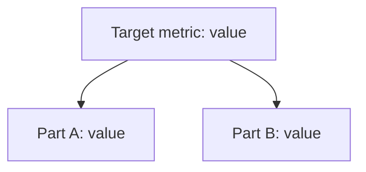
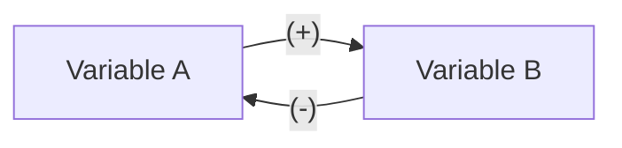

# Tradeoff card template

There are three shapes. Use the full card unless the gate stopped early (the short card) or the user asked for a quick take (the lite card). Fill every line of the shape you use, in this order. Keep each line short. Replace every placeholder in angle brackets.

## Full card

# Tradeoff card: <decision>

* **The call:** <Go | Go with guardrails | Redesign | Don't>, in one sentence.
* **The need:** "<the requester's words>", or the goal in a few words when there is no requester to quote.
* **Domain:** <Clear | Complicated | Complex | Chaotic | Confusion> (Cynefin): <the evidence from the five tests>
* **Who leads:** <Reductionist | Systems thinker | split: part A Reductionist, part B Systems thinker> because <the deciding tests>
* **Deciding input:** <the fact that decides the call>. <Given: its value | Assumed: its range>, against <the threshold where the call changes>.
* **Assumption share:** <N of M inputs assumed>. <The call holds across the range | The call flips at <value>, and how the call handles that>.
* **What we give up:** <the cost or option the call trades away>
* **Revisit when:** <a date or a metric level>

When there are several options, add a line after the need: **Options:** each option, with any that misses the need marked off-need and the words it misses.

## Reductionism (zoom in)

**Metric tree**

* **Lever:** <the node the change pulls, and which way>
* **Numbers:** <the formula, then low, base and high case, one line of arithmetic each>
* **Break-even:** <one line of arithmetic>
* **Test:** <metric, success threshold, rough duration or sample>

## Systems thinking (zoom out)

**Loop map**

| Loop | Type | Links | Delay | Who reacts and why | Signal to watch |
|---|---|---|---|---|---|
| <name> | <R or B> | <A -> B (+), B -> A (-)> | <days, weeks, months or quarters> | <actor: what they see and what they do> | <metric, and when it first shows> |

* **Archetype:** <name, and which loop is which, or none>
* **Second-order effects:** <one to three lines>

## The clash

| From | Challenge | Reply |
|---|---|---|
| Reductionist to Systems thinker | <one sentence> | <one sentence> |
| Systems thinker to Reductionist | <one sentence> | <one sentence> |

## The call

* **Decision:** <Go | Go with guardrails | Redesign | Don't>
* **Guardrails:** <metric and limit, one for each concern of the lens that does not lead>
* **Holdout:** <who is held out, and for how long>
* **Revisit trigger:** <a date or a metric level>
* **What would change the call:** <the result or fact that would flip it>

## Assumptions to check

1. <assumption, and how to check it>

## Short card: Get X first

Use it when the gate stops before the lenses: the deciding input is unknown, it decides between the options, and finding it out costs a question or a lookup.

# Tradeoff card: <decision>

* **The call:** Get <the deciding input> first.
* **The need:** "<the requester's words>"
* **Why it decides:** <which option wins changes with this input>
* **What to ask:** "<the question, ready to send>", to <whom>.
* **Thresholds:** <option A> below <T1>; <option B> from <T1> to <T2>; <option C> above <T2>.
* **Off-need:** <option: the words of the need it misses>, or none.
* **Revisit when:** <the deciding input> is known. Then run the full card on the option it points to.

## Lite card

Use it for a quick take. One pass in the main conversation, no lens agents, no clash table.

# Tradeoff card (lite): <decision>

* **The call:** <Go | Go with guardrails | Redesign | Don't | Get X first>, in one sentence.
* **The need:** "<the requester's words>"
* **Key number:** <the one calculation that matters, with its break-even>
* **Key loop:** <the one loop that matters: who reacts, why, the delay and the signal>
* **Deciding input:** <the fact that decides the call: given or assumed>. **Assumption share:** <N of M inputs assumed>.
* **Revisit when:** <a date or a metric level>

Ask for the full card to run both lens agents and the clash.
