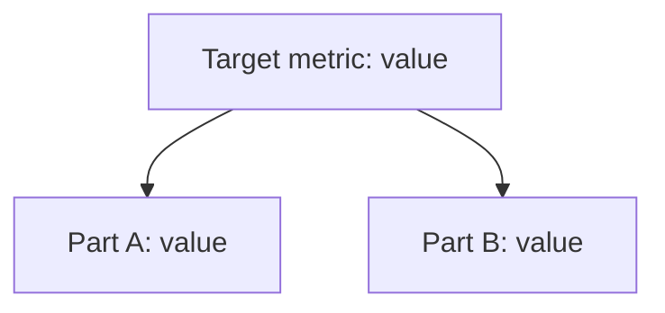
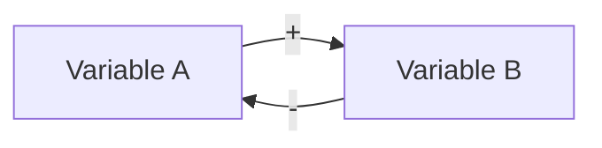

# Tradeoff card template

Fill every section, in this order. Keep each section short. Replace every placeholder in angle brackets.

# Tradeoff card: <decision>

* **The call:** <Go | Go with guardrails | Redesign | Don't>, in one sentence.
* **Domain:** <Clear | Complicated | Complex | Chaotic | Confusion> (Cynefin): <the evidence from the five tests>
* **Who leads:** <Reductionist | Systems thinker | split: part A Reductionist, part B Systems thinker> because <the deciding tests>
* **What we give up:** <the cost or option the call trades away>
* **Revisit when:** <a date or a metric level>

## Reductionism (zoom in)

**Metric tree**

* **Lever:** <the node the change pulls, and which way>
* **Numbers:** <the formula, then low, base and high case, one line of arithmetic each>
* **Break-even:** <one line of arithmetic>
* **Test:** <metric, success threshold, rough duration or sample>

## Systems thinking (zoom out)

**Loop map**

| Loop | Type | Links | Delay | Who reacts and why | Signal to watch |
|---|---|---|---|---|---|
| <name> | <R or B> | <A -> B (+), B -> A (-)> | <days, weeks, months or quarters> | <actor: what they see and what they do> | <metric, and when it first shows> |

* **Archetype:** <name, and which loop is which, or none>
* **Second-order effects:** <one to three lines>

## The clash

| From | Challenge | Reply |
|---|---|---|
| Reductionist to Systems thinker | <one sentence> | <one sentence> |
| Systems thinker to Reductionist | <one sentence> | <one sentence> |

## The call

* **Decision:** <Go | Go with guardrails | Redesign | Don't>
* **Guardrails:** <metric and limit, one for each concern of the lens that does not lead>
* **Holdout:** <who is held out, and for how long>
* **Revisit trigger:** <a date or a metric level>
* **What would change the call:** <the result or fact that would flip it>

## Assumptions to check

1. <assumption, and how to check it>
