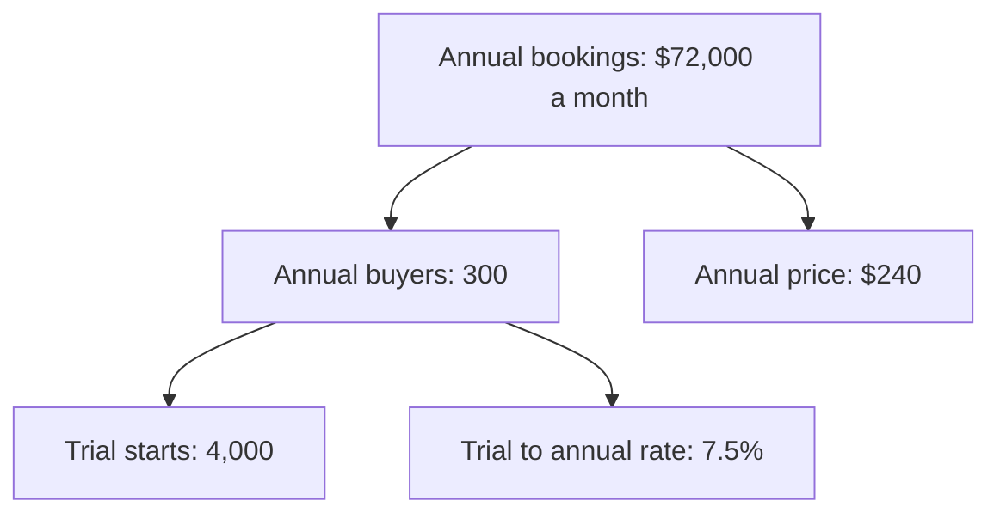
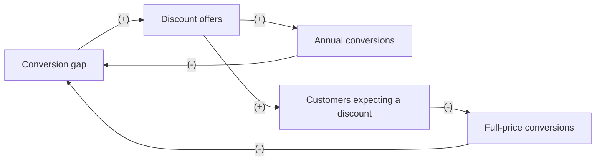

# Case: 20% off the annual plan

## The situation

Fernbook is a fictional bookkeeping app for freelancers. It sells a monthly plan at $25 a month and an annual plan at $240 a year. It has never run a discount.

* 4,000 people start a free trial each month.
* 25% of trials buy a plan within 90 days: 7.5% buy annual and 17.5% buy monthly. That is 300 annual buyers a month, or $72,000 of annual bookings.
* Monthly buyers pay for about 8 months in their first year.
* Growth wants to show 20% off the annual plan ($192 a year) to every trial user, to lift conversion.

**Your task:** name the need and the input that decides the call, place the decision in a Cynefin domain, say who leads, and make one call: Go, Go with guardrails, Redesign, Don't, or Get X first. Show your reasoning: a number or two for the direct effect, and at least one loop.

<!-- solution: do not show before the user answers -->

# Tradeoff card: 20% off the annual plan

* **The call:** Go with guardrails: a targeted, time-boxed offer with a never-discounted holdout, not a standing discount for everyone.
* **The need:** "to lift conversion" (growth).
* **Domain:** Complex (Cynefin): customers react by learning to wait for deals, the effect feeds back with a delay of one to two quarters, price is a signal every buyer shares, and the cost lands after a short test ends.
* **Who leads:** Systems thinker because the reactors, feedback with delay and time horizon tests all point outside what a short test can see. The Reductionist sizes the probe and its thresholds.
* **Deciding input:** how much the trial to annual rate rises at $192. Assumed: up 10% to 33%, against the 25% it needs to break even. Only an offer reveals it.
* **Assumption share:** 1 of 3 inputs assumed (trial starts and the 7.5% rate are given). The money flips inside the range, from a $8,640 monthly loss to a $4,800 gain, and only acting can measure it, so the call is a capped probe, not a launch.
* **What we give up:** the simple read of a sitewide test, and up to about $6,900 a month of annual bookings during the probe if the low case is true (80% of the low-case $8,640).
* **Revisit when:** the 12-week probe ends, or at once if the holdout's 90-day full-price conversion falls below 23%.

## Reductionism (zoom in)

**Metric tree**

* **Lever:** annual price down 20%, from $240 to $192, to pull the trial to annual rate up.
* **Numbers:** annual bookings = trial starts x trial to annual rate x annual price.
  * Today: 4,000 x 7.5% = 300 buyers; 300 x $240 = $72,000.
  * Low (rate up 10%, to 8.25%): 4,000 x 8.25% = 330; 330 x $192 = $63,360, a loss of $8,640.
  * Base (rate up 20%, to 9%): 4,000 x 9% = 360; 360 x $192 = $69,120, a loss of $2,880.
  * High (rate up 33%, to 10%): 4,000 x 10% = 400; 400 x $192 = $76,800, a gain of $4,800.
* **Break-even:** annual buyers must rise 25%, because 1.25 x 0.8 = 1.0: 300 x 1.25 = 375 buyers, and 375 x $192 = $72,000. A buyer who switches from monthly brings $192 instead of about $200 ($25 x 8 months), close to a wash, so only new payers count toward the 25%.
* **Test:** trial to annual rate, 50/50 split of new trials. Success: 9.4% or more (7.5% x 1.25). About 3,400 trials per arm to see 7.5% against 9.4% at 80% power, so 7 to 8 weeks at 4,000 trials a month.

## Systems thinking (zoom out)

**Loop map**

| Loop | Type | Links | Delay | Who reacts and why | Signal to watch |
|---|---|---|---|---|---|
| B1 Quick fix | B | Conversion gap -> Discount offers (+), Discount offers -> Annual conversions (+), Annual conversions -> Conversion gap (-) | Days | Trial users: a lower price tips the undecided into buying now | Trial to annual rate in the offer group, in the first 2 weeks |
| R1 Learned waiting | R | Conversion gap -> Discount offers (+), Discount offers -> Customers expecting a discount (+), Customers expecting a discount -> Full-price conversions (-), Full-price conversions -> Conversion gap (-) | 1 to 2 quarters | Trial users and their peers: they see or hear of the offer and wait for the next one instead of paying full price | 90-day full-price conversion and median days from trial start to purchase, against the holdout, from month 3 |

* **Archetype:** fixes that fail. B1 is the quick fix; R1 is the delayed side effect that brings the gap back.
* **Second-order effects:** a team that hits its target with a discount will be asked to hit the next one the same way. Discounted buyers renew at $240 a year later, and some will churn at the jump.

## The clash

| From | Challenge | Reply |
|---|---|---|
| Reductionist to Systems thinker | How big is learned waiting? If it is small, the loop does not matter. | Unknown, and invisible in an 8-week test. The holdout's 90-day full-price conversion sizes it; until then, cap the exposure. |
| Systems thinker to Reductionist | Your base case loses $2,880 a month before anyone learns to wait. Why test a sitewide discount at all? | Because the range runs from a $8,640 loss to a $4,800 gain. A targeted, time-boxed probe gets the same read with less exposure. |

## The call

* **Decision:** Go with guardrails. Each trial in the probe arm sees $192 once, in a 7-day window at the end of its trial. Existing monthly customers never see it. The probe runs 12 weeks and does not repeat for 12 months.
* **Probe size (Reductionist):** about 11,000 trials in 12 weeks: about 8,900 in the probe arm and 2,200 in the holdout, enough to see 7.5% against 9.4% at about 80% power. Success: a trial to annual rate of 9.4% or more in the probe arm.
* **Guardrails:** stop if the holdout's 90-day full-price conversion falls below 23% (baseline 25%), or if median days from trial start to purchase in the probe arm rises more than 3 days above the holdout.
* **Holdout:** 20% of new trials never see a discount, kept for 6 months.
* **Revisit trigger:** the end of the 12-week probe, or any guardrail breach.
* **What would change the call:** a fall in the holdout's full-price conversion makes it Don't. A lift of 25% or more with flat full-price conversion over 6 months makes it Go for a once-a-year, time-boxed offer.

## Assumptions to check

1. The extra annual buyers are new payers, not switchers from monthly. Check the monthly share in the probe arm.
2. Word of the offer does not reach the holdout. Check support questions and deal-site mentions during the probe.
3. Monthly buyers pay about 8 months in year one. Check the last two cohorts.
4. The offer page changes only the price. Check that the copy and layout match the holdout.
