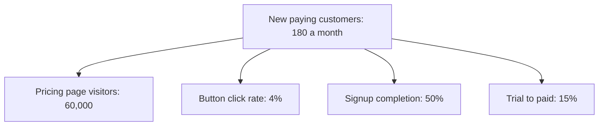
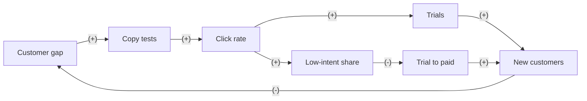

# Case: rewrite the pricing page button

## The situation

Plotwick is a fictional project planning tool for small teams. Its pricing page has one main button, "Start free trial". The trial already needs no card.

* 60,000 people visit the pricing page each month.
* 4% click the button (2,400), 50% of those finish signup (1,200 trials), and 15% of trials become paying customers: 180 a month at $40 a month each.
* Design wants the button to say "Try it free for 14 days, no card needed".
* Marketing worries that a softer promise will bring in people who were only browsing.

**Your task:** name the need and the input that decides the call, place the decision in a Cynefin domain, say who leads, and make one call: Go, Go with guardrails, Redesign, Don't, or Get X first. Show your reasoning: a number or two for the direct effect, and at least one loop.

<!-- solution: do not show before the user answers -->

# Tradeoff card: rewrite the pricing page button

* **The call:** Go: test the new copy against the old for about 6 weeks and keep the winner.
* **The need:** more paying customers from the pricing page, through design's ask to say "Try it free for 14 days, no card needed".
* **Domain:** Complicated (Cynefin): one button changes, the effect shows within days, nobody outside the company reacts, and a clean A/B test can read it.
* **Who leads:** Reductionist because the separability, time horizon and reactors tests all point to analysis. The Systems thinker's concern about trial quality becomes a guardrail.
* **Deciding input:** the click lift. Assumed: 5% to 20%, from 4% to between 4.2% and 4.8%. Trial to paid must stay at 13.6% or more for the base case to gain.
* **Assumption share:** 2 of 4 inputs assumed (the click lift and trial quality; visitors and signup completion are given). The 6-week test measures the first, and the guardrail watches the second.
* **What we give up:** half the traffic stays on the weaker copy for 6 weeks: at most about 27 customers if the high case is true (36 a month x 50% x 1.5 months).
* **Revisit when:** the test reaches about 39,400 visitors per arm, or at once if trial to paid in the new arm falls below 13.6%.

## Reductionism (zoom in)

**Metric tree**

* **Lever:** the button click rate.
* **Numbers:** new paying customers = visitors x click rate x signup completion x trial to paid.
  * Today: 60,000 x 4% x 50% x 15% = 180.
  * Low (click rate to 4.2%): 60,000 x 4.2% x 50% x 15% = 189, 9 more a month.
  * Base (4.4%): 60,000 x 4.4% x 50% x 15% = 198, 18 more a month, $720 more in monthly revenue from each month's signups.
  * High (4.8%): 60,000 x 4.8% x 50% x 15% = 216, 36 more a month.
* **Break-even:** copy costs almost nothing, so the risk is weaker trials. In the base case, new customers stay above 180 as long as trial to paid stays above 180 / 1,320 = 13.6%.
* **Test:** click rate, 50/50 split of pricing page visitors. Success: 4.4% or more. About 39,400 visitors per arm see 4% against 4.4% at 80% power: about 6 weeks at 60,000 a month. Paying customers per visitor would be the better metric, but 0.30% against 0.33% needs about 547,000 visitors per arm, 18 months. So clicks lead and trial to paid is the guardrail.

## Systems thinking (zoom out)

**Loop map**

| Loop | Type | Links | Delay | Who reacts and why | Signal to watch |
|---|---|---|---|---|---|
| B1 Copy testing | B | Customer gap -> Copy tests (+), Copy tests -> Click rate (+), Click rate -> Trials (+), Trials -> New customers (+), New customers -> Customer gap (-) | 6 to 8 weeks | The growth team: tests run until the gap closes | New customers per 1,000 visitors, per test |
| R1 Weaker trials | R | Customer gap -> Copy tests (+), Copy tests -> Click rate (+), Click rate -> Low-intent share (+), Low-intent share -> Trial to paid (-), Trial to paid -> New customers (+), New customers -> Customer gap (-) | 2 to 4 weeks | Visitors: a softer promise brings in people who were only browsing, and they buy less | Trial to paid by arm, 14 days after each trial starts |

* **Archetype:** none. Both loops are short and close inside the test window, so the test can see them.
* **Second-order effects:** saying "no card needed" on the button may also cut support questions about cards, a small gain the test will not count.

## The clash

| From | Challenge | Reply |
|---|---|---|
| Systems thinker to Reductionist | Clicks are a proxy. A softer promise can lift clicks and lower trial quality. | Agreed, and paid conversion is too rare to power in under a year. So clicks are the success metric and trial to paid is a guardrail, read 14 days after each trial starts. |
| Reductionist to Systems thinker | Do your loops show up after the test window? | No. Both close within 2 to 8 weeks, so the test sees them. That is why the Reductionist leads here. |

## The call

* **Decision:** Go. A/B test the new copy against the old, 50/50, for about 6 weeks, and keep the winner.
* **Probe size (Reductionist):** about 39,400 visitors per arm, 78,800 in total, which is about 6 weeks at 60,000 a month. Success: a click rate of 4.4% or more.
* **Guardrails:** trial to paid in the new arm at 13.6% or more, read 14 days after each trial starts, and signup completion within 5 points of the old arm.
* **Holdout:** the old copy is the control arm. No long-term holdout is needed for a change this easy to undo.
* **Revisit trigger:** the end of the test, or a guardrail breach.
* **What would change the call:** more clicks with trial to paid below 13.6% makes it Redesign: keep the clearer promise and add who the tool is for.

## Assumptions to check

1. "No card needed" is true today. Check the signup flow before the test starts.
2. Pricing page traffic stays near 60,000 a month during the test. Check last year's same weeks.
3. Clicks on the new copy finish signup at the same 50%. Check signup completion by arm.
