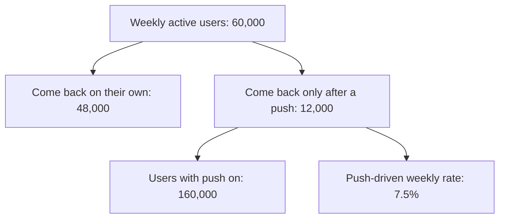
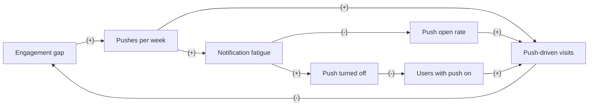

# Case: a daily push notification

## The situation

Mintpotter is a fictional recipe and meal-planning app. It sends 2 push notifications a week today: recipe ideas on Tuesday and Friday.

* 200,000 people use the app each month, and 160,000 of them (80%) have push turned on.
* 60,000 are active each week: 48,000 come back on their own, and 12,000 come back only after a push. That is 7.5% of the users with push on.
* Each push makes about 0.05% of the people who get it turn push off.
* Growth wants a daily "tonight's dinner idea" push for everyone with push on, to lift weekly active users.

**Your task:** name the need and the input that decides the call, place the decision in a Cynefin domain, say who leads, and make one call: Go, Go with guardrails, Redesign, Don't, or Get X first. Show your reasoning: a number or two for the direct effect, and at least one loop.

<!-- solution: do not show before the user answers -->

# Tradeoff card: a daily push notification

* **The call:** Redesign: an opt-in daily reminder at a time the user picks, and a cap of 4 pushes a week per user across all teams, tested against a holdout. Not a daily push for everyone.
* **The need:** "to lift weekly active users" (growth).
* **Domain:** Complex (Cynefin): users adapt by tuning out or turning push off, the cost builds over weeks while a short test sees the novelty, and attention is shared by every team that sends a push.
* **Who leads:** Systems thinker because the reactors, feedback with delay and shared things tests all point past what a 2-week test can see. The Reductionist sizes the probe and its thresholds.
* **Deciding input:** how fast push fatigue builds: the open rate per push and opt-outs per push after week 4. Assumed: opt-outs stay at 0.05% per push or double. Only acting reveals it.
* **Assumption share:** 2 of 4 inputs assumed (the push-driven rate at 7 a week, and fatigue). The direct numbers stay positive even if opt-outs double, so the call turns on the loop, which only a probe can measure.
* **What we give up:** up to about 4,800 extra weekly actives in the first weeks (the base case), if a daily push for everyone would have held up.
* **Revisit when:** the 8-week probe ends, or at once if opt-outs pass 0.15% of recipients on any push.

## Reductionism (zoom in)

**Metric tree**

* **Lever:** pushes per week from 2 to 7, to raise the push-driven weekly rate.
* **Numbers:** push-driven actives = users with push on x push-driven weekly rate.
  * Today: 160,000 x 7.5% = 12,000; 48,000 + 12,000 = 60,000 weekly actives.
  * Low (rate to 9%): 160,000 x 9% = 14,400; 62,400 weekly actives, 2,400 more (+4%).
  * Base (rate to 10.5%): 160,000 x 10.5% = 16,800; 64,800 weekly actives, 4,800 more (+8%).
  * High (rate to 12%): 160,000 x 12% = 19,200; 67,200 weekly actives, 7,200 more (+12%).
  * Opt-outs: 7 pushes x 0.05% = 0.35% a week, 560 people, against 2 x 0.05% = 0.1%, 160 people, today. That is 400 more a week.
* **Break-even:** each person who turns push off takes away about 0.105 weekly actives at the base rate. The base gain of 4,800 is gone after 4,800 / 0.105 = 45,714 extra opt-outs, which takes 45,714 / 400 = 114 weeks. On its direct numbers the daily push pays for two years, if both rates hold.
* **Test:** push-driven weekly rate among users with push on, 50/50 split, 2 weeks. Success: 10.5% or more. About 1,400 users per arm see 7.5% against 10.5% at 80% power, so the test is easy to power.

## Systems thinking (zoom out)

**Loop map**

| Loop | Type | Links | Delay | Who reacts and why | Signal to watch |
|---|---|---|---|---|---|
| B1 Quick lift | B | Engagement gap -> Pushes per week (+), Pushes per week -> Push-driven visits (+), Push-driven visits -> Engagement gap (-) | Days | Users who were drifting away: a dinner idea at 5 pm brings some of them back | Push-driven weekly rate in the first 2 weeks |
| R1 Tuning out | R | Engagement gap -> Pushes per week (+), Pushes per week -> Notification fatigue (+), Notification fatigue -> Push open rate (-), Push open rate -> Push-driven visits (+), Push-driven visits -> Engagement gap (-) | 4 to 8 weeks | Users: a daily push turns into background noise, so they stop opening any push, cooking timer alerts included | Open rate per push, week by week, against the holdout |
| R2 Losing the channel | R | Engagement gap -> Pushes per week (+), Pushes per week -> Notification fatigue (+), Notification fatigue -> Push turned off (+), Push turned off -> Users with push on (-), Users with push on -> Push-driven visits (+), Push-driven visits -> Engagement gap (-) | 2 to 6 months | Users: some turn push off for good, and then no team can reach them | Opt-outs per push sent, and the share of users with push on, monthly |

* **Archetype:** tragedy of the commons, with fixes that fail inside it. Attention is shared by every team that sends a push. Each team gains from its own pushes, and the fatigue lands on all of them.
* **Second-order effects:** once growth sends daily, other teams ask for the same. Cooking timer alerts get ignored along with the recipe ideas, which hurts the feature people rely on most.

## The clash

| From | Challenge | Reply |
|---|---|---|
| Reductionist to Systems thinker | The direct numbers pay for two years even with today's opt-out rate. Where is the evidence that fatigue is large? | Opt-outs per push are not fixed: they rise as fatigue builds, and a 2-week test sees the novelty, not the habit. The holdout's open rate in weeks 5 to 8 sizes it. |
| Systems thinker to Reductionist | Your break-even assumes 0.05% opt-outs per push forever. What if it doubles by week 6? | Then it is 7 x 0.1% = 0.7% a week, 1,120 people, 960 more than today, and the base gain is gone in 45,714 / 960 = 48 weeks instead of 114. Still positive, but every opt-out is permanent and the open-rate decay is not in my numbers. |

## The call

* **Decision:** Redesign. Offer an opt-in daily dinner reminder, at a time the user picks, after they save a recipe. Cap pushes at 4 a week per user across all teams.
* **Probe size (Reductionist):** 16,000 users with push on (10%) in the redesign arm and 16,000 in a holdout on today's 2 pushes a week, for 8 weeks. That is about 3 times the 5,300 per arm needed to see 7.5% against 9% at 80% power. Success: a push-driven weekly rate of 9% or more, with the open rate per push in weeks 5 to 8 within 10% of weeks 1 and 2.
* **Guardrails:** stop if opt-outs pass 0.15% of recipients on any push, or if the open rate on cooking timer alerts falls 10% or more against the holdout.
* **Holdout:** 16,000 users stay on 2 pushes a week for the 8 weeks.
* **Revisit trigger:** the end of week 8, or any guardrail breach.
* **What would change the call:** a flat open rate through week 8 with opt-outs under 0.05% per push makes it Go with guardrails for a daily push to everyone who opted in. An open rate down 20% or more by week 8 makes it Don't, and the cap drops to 3.

## Assumptions to check

1. The 12,000 push-driven actives would not have come back that week without the push. Check with the holdout.
2. Opt-outs stay near 0.05% per push at 2 pushes a week. Check the last 8 weeks.
3. People who opt in to a daily reminder are not only the people who already come back daily. Check their activity the week before.
4. Every team that sends pushes accepts a shared cap. Check before the probe starts.
