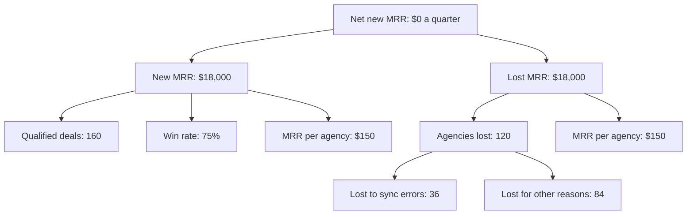
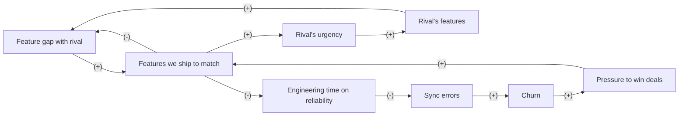

# Case: match a rival's feature list

## The situation

Ledgerbird is a fictional invoicing app for small agencies. 2,000 agencies pay $150 a month.

* Sales works 160 qualified deals a quarter and wins 75% (120). Each new agency adds $150 of monthly revenue (MRR), so new MRR is $18,000 a quarter.
* 2% of agencies leave each month, 120 a quarter, which takes $18,000 of MRR a quarter. Growth is flat. 30% of the agencies that leave name invoice sync errors as the reason.
* Billcove, a fictional and larger rival, was in 60 of the deals: Ledgerbird won 35 and lost 25, and in all 25 the buyer named a missing feature. Billcove ships about 8 new features a quarter.
* The CEO wants to match Billcove's list: 12 missing features, about 2 quarters of the whole 10-engineer team.

**Your task:** name the need and the input that decides the call, place the decision in a Cynefin domain, say who leads, and make one call: Go, Go with guardrails, Redesign, Don't, or Get X first. Show your reasoning: a number or two for the direct effect, and at least one loop.

<!-- solution: do not show before the user answers -->

# Tradeoff card: match a rival's feature list

* **The call:** Don't. Fix invoice sync next quarter, and probe the single most-cited missing feature.
* **The need:** stop losing deals to the rival, through the CEO's ask to "match Billcove's list".
* **Domain:** Complex (Cynefin): the rival reacts to every move, the race feeds itself, and the cost of neglecting reliability lands quarters later.
* **Who leads:** Systems thinker because the reactors, feedback with delay and time horizon tests all point past the next quarter's deals. The Reductionist sizes both options.
* **Deciding input:** how many of the 25 losses parity would win back. Assumed: 5 to 12 a quarter, against the 18 it needs to beat the sync fix. Calling 5 of those buyers would check it cheaply.
* **Assumption share:** 1 of 5 inputs assumed. The call holds across the range, since even the high case, 12, is below the 18 needed, so it does not wait for those calls.
* **What we give up:** the deals a missing feature truly decides, about 8 a quarter in the base case, $1,200 of MRR, and the sales line "we have everything they have".
* **Revisit when:** sync-related churn falls below 0.3% a month, or the win rate against the rival falls below 50% for a quarter.

## Reductionism (zoom in)

**Metric tree**

* **Lever:** win rate against the rival through parity, or churn through a sync fix. One team cannot do both next quarter.
* **Numbers:** new MRR = qualified deals x win rate x $150; lost MRR = agencies lost x $150.
  * Today: 160 x 75% x $150 = $18,000 new; 120 x $150 = $18,000 lost; net $0.
  * Parity, low (wins back 5 of the 25 losses a quarter): 5 x $150 = $750 more MRR a quarter.
  * Parity, base (8 of 25): 8 x $150 = $1,200.
  * Parity, high (12 of 25): 12 x $150 = $1,800.
  * Sync fix (halves sync losses, 36 to 18 a quarter): 18 x $150 = $2,700 more MRR a quarter, after 1 quarter of work instead of 2.
* **Break-even:** parity must win back $2,700 / $150 = 18 deals a quarter to match the sync fix, 72% of the 25 losses, and it starts a quarter later.
* **Test:** build only the most-cited feature, time tracking, named in 11 of the 25 losses, as a 4-week slice. Read the win rate in deals where it comes up for one quarter. About 20 deals is too few for a significant read, so it is directional.

## Systems thinking (zoom out)

**Loop map**

| Loop | Type | Links | Delay | Who reacts and why | Signal to watch |
|---|---|---|---|---|---|
| B1 Close the gap | B | Feature gap with rival -> Features we ship to match (+), Features we ship to match -> Feature gap with rival (-) | 2 quarters | Our team: each feature shipped shrinks the list sales brings back | Missing features named in lost deals, per quarter |
| R1 Arms race | R | Features we ship to match -> Rival's urgency (+), Rival's urgency -> Rival's features (+), Rival's features -> Feature gap with rival (+), Feature gap with rival -> Features we ship to match (+) | 1 to 2 quarters | The rival: when we close in, it ships faster to keep its lead | Features the rival ships per quarter, from its public changelog |
| R2 Core decay | R | Features we ship to match -> Engineering time on reliability (-), Engineering time on reliability -> Sync errors (-), Sync errors -> Churn (+), Churn -> Pressure to win deals (+), Pressure to win deals -> Features we ship to match (+) | 2 to 3 quarters | Customers: sync errors pile up while the team builds parity, and agencies leave | Sync-related churn, monthly |

* **Archetype:** escalation (R1). Each side's move is the other side's reason to move. R2 adds shifting the burden: matching features stands in for fixing the product's own weak spot, and the weak spot grows.
* **Second-order effects:** a longer feature list makes the product harder to learn, and sales starts selling the list instead of the job agencies hire it for.

## The clash

| From | Challenge | Reply |
|---|---|---|
| Reductionist to Systems thinker | 25 lost deals named a missing feature. Is the rival's reaction more than a story? | The rival ships about 8 features a quarter whatever we do. By the time our 12 ship in 2 quarters, it has shipped about 16 more, so parity never arrives. |
| Systems thinker to Reductionist | Buyers name a feature when they leave. Does the feature decide the deal? | Partly. In the base case parity wins back 8 of 25, $1,200 of MRR a quarter, against $2,700 for the sync fix. The numbers agree with the loop. |

## The call

* **Decision:** Don't match the list. Spend next quarter on invoice sync errors, and probe the single most-cited missing feature.
* **Probe size (Reductionist):** 3 engineers build time tracking as a 4-week slice. Read the win rate in deals where time tracking comes up for one quarter, about 20 deals, as a directional signal.
* **Guardrails:** sync-related churn tracked monthly; the win rate against the rival at 50% or more each quarter (35 of 60, 58%, today).
* **Holdout:** none. A feature cannot be withheld from some buyers in a sales call, so compare against the previous two quarters.
* **Revisit trigger:** sync-related churn below 0.3% a month (today 36 a quarter, 12 a month, 0.6%), or the win rate against the rival below 50% for a quarter.
* **What would change the call:** time tracking lifting the win rate in its deals by 15 points or more makes it Go with guardrails for the next most-cited feature, one at a time.

## Assumptions to check

1. The 25 losses would have been wins with the features. Check by calling 5 of those buyers.
2. Sync errors cause the churn they are blamed for. Check the error logs of agencies that left.
3. The rival keeps shipping about 8 features a quarter. Check its public changelog.
