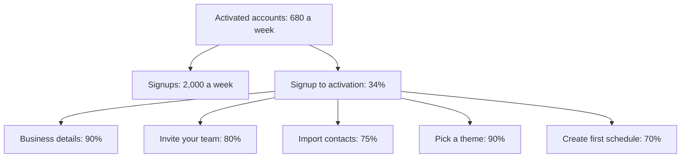
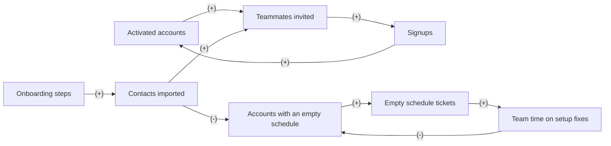

# Case: Cut onboarding from 5 steps to 3

## The situation

Kitewell is a fictional shift scheduling app for small teams. New accounts go through 5 onboarding steps before they reach the app.

* 2,000 accounts sign up each week.
* Step pass rates: 1 Business details 90%, 2 Invite your team 80%, 3 Import contacts 75%, 4 Pick a theme 90%, 5 Create your first schedule 70%.
* Activation means a first schedule within 7 days. Today 34% of signups activate, about 680 a week.
* Activated accounts invite 2.5 teammates in their first 14 days, and 60% are still active in week 4. Support gets 8 tickets about empty schedules per 1,000 new accounts.
* Product wants to cut onboarding to 3 steps by moving Import contacts and Pick a theme into the app, after the first schedule.

**Your task:** name the need and the input that decides the call, place the decision in a Cynefin domain, say who leads, and make one call: Go, Go with guardrails, Redesign, Don't, or Get X first. Show your reasoning: a number or two for the direct effect, and at least one loop.

<!-- solution: do not show before the user answers -->

# Tradeoff card: Cut onboarding from 5 steps to 3

* **The call:** Go with guardrails: test the 3-step flow on half of signups and keep it if activation rises at least 10% while activation quality holds.
* **The need:** more signups reaching a first schedule within 7 days, through product's ask to "cut onboarding to 3 steps".
* **Domain:** Complicated (Cynefin): the effect separates step by step, users do not adapt their behaviour to the number of steps, nothing shared is drawn down, and both activation (7 days) and week-4 retention land inside a 7-week read.
* **Who leads:** Reductionist because the separability and time horizon tests pass: funnel math predicts most of the effect and a short test confirms it. The Systems thinker's loops become guardrails.
* **Deciding input:** the step 5 pass rate after the cut. Assumed: 50% to 70%. Activation holds at 34% while it stays at 47% or more.
* **Assumption share:** 1 of 6 inputs assumed (the five step rates today are given). The call holds across the range: even the low case, 50%, is above the 47% break-even.
* **What we give up:** contacts imported up front, which can make first schedules emptier, and 7 weeks before the result is final.
* **Revisit when:** week 7 of the test (3 weeks of signups, then 4 weeks to read retention), or at once on a guardrail breach.

## Reductionism (zoom in)

**Metric tree**

* **Lever:** remove steps 3 and 4, so their 75% and 90% pass rates become 100%, at the risk of a lower pass rate on step 5 without contacts.
* **Numbers:** activation = product of the step pass rates. Today: 0.9 x 0.8 x 0.75 x 0.9 x 0.7 = 34.0%; 2,000 x 34.0% = 680 a week.
  * High (step 5 stays at 70%): 0.9 x 0.8 x 0.7 = 50.4%; 2,000 x 50.4% = 1,008 a week, 328 more (+48%).
  * Base (step 5 falls to 60%): 0.9 x 0.8 x 0.6 = 43.2%; 2,000 x 43.2% = 864 a week, 184 more (+27%).
  * Low (step 5 falls to 50%): 0.9 x 0.8 x 0.5 = 36.0%; 2,000 x 36.0% = 720 a week, 40 more (+6%).
* **Break-even:** activation stays at 34.0% as long as step 5 passes 47% or more: 34.0% / (0.9 x 0.8) = 34.0% / 72% = 47%.
* **Test:** activation within 7 days, 50/50 split of signups. Success: 37.4% or more (34.0% x 1.1). About 3,100 signups per arm to see 34.0% against 37.4% at 80% power, so about 3 weeks of signups, then 4 weeks to read week-4 retention.

## Systems thinking (zoom out)

**Loop map**

| Loop | Type | Links | Delay | Who reacts and why | Signal to watch |
|---|---|---|---|---|---|
| R1 Team invites | R | Activated accounts -> Teammates invited (+), Teammates invited -> Signups (+), Signups -> Activated accounts (+) | Weeks for invites, 1 to 2 quarters for signups | New admins invite staff from their imported contacts; staff who use the app at one job bring it to the next | Teammates invited per activated account in the first 14 days (baseline 2.5), from week 2 |
| B1 Setup fixes | B | Accounts with an empty schedule -> Empty schedule tickets (+), Empty schedule tickets -> Team time on setup fixes (+), Team time on setup fixes -> Accounts with an empty schedule (-) | 2 to 4 weeks | Support and the product team: tickets about empty schedules pile up, so the team adds an import prompt inside the app | Empty schedule tickets per 1,000 new accounts (baseline 8), weekly from week 1 |

* **Archetype:** none. R1 is a plain growth loop and B1 a plain correction; neither matches a classic archetype.
* **Second-order effects:** if activation rises but invites fall, activated accounts are smaller teams, and single-admin accounts churn more, so week-4 retention can drop even as activation climbs.

## The clash

| From | Challenge | Reply |
|---|---|---|
| Reductionist to Systems thinker | Do your loops change the decision, or only what we watch? | Only what we watch. Both loops show within 2 to 4 weeks, so guardrails can catch them inside the test. |
| Systems thinker to Reductionist | Your high case assumes step 5 does not need contacts. Why would it not? | It might need them; that is the base and low case. Even at 50% on step 5, activation still rises, and break-even is 47%. |

## The call

* **Decision:** Go with guardrails. Run the 3-step flow on 50% of signups for 3 weeks and ship it if activation reaches 37.4% or more.
* **Guardrails:** teammates invited per activated account no lower than 2.25 (10% under 2.5); week-4 retention of activated accounts no more than 3 points under control (60%); empty schedule tickets no higher than 12 per 1,000 new accounts (baseline 8).
* **Holdout:** after the ship, 10% of signups keep the 5-step flow for 8 weeks.
* **Revisit trigger:** week 7 of the test, or any guardrail breach.
* **What would change the call:** step 5 falling below 47%, or invites per account falling more than 10%, makes it Redesign: keep 3 steps but put a one-tap contact import on the first schedule screen.

## Assumptions to check

1. Steps 1 and 2 keep their pass rates when steps 3 and 4 move. Check both in the test.
2. Step 5 depends on contacts mainly for names to schedule. Check how many first schedules use imported contacts today.
3. The split happens after signup, so signups are the same in both arms. Check the assignment logs.
