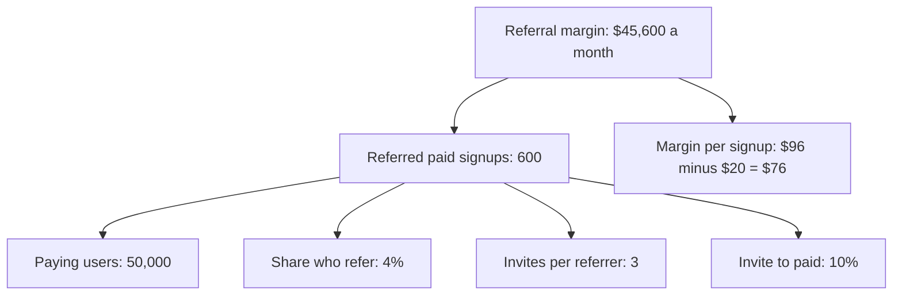
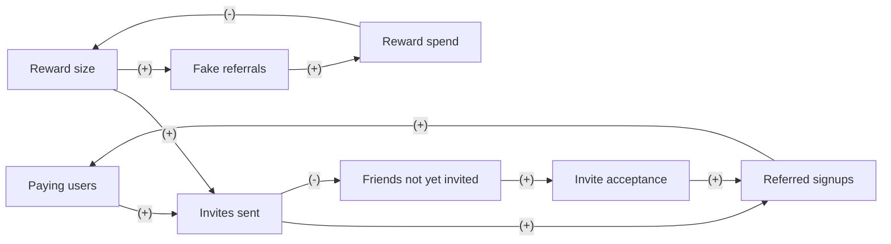

# Case: Double the referral reward

## The situation

Pocketgrove is a fictional budgeting app with a paid plan at $8 a month.

* 50,000 paying users. Each month 4% of them send invites: 2,000 referrers, 3 invites each, 6,000 invites.
* 10% of invites become paying users: 600 referred paid signups a month.
* Today the referrer and the friend each get $10 of credit when the friend's first paid month starts: $20 per referred signup, $12,000 a month.
* A paying user brings about $96 of gross margin over their lifetime: $8 x 15 months x 80% margin.
* Growth wants to double the reward to $20 each, $40 per referred signup.

**Your task:** name the need and the input that decides the call, place the decision in a Cynefin domain, say who leads, and make one call: Go, Go with guardrails, Redesign, Don't, or Get X first. Show your reasoning: a number or two for the direct effect, and at least one loop.

<!-- solution: do not show before the user answers -->

# Tradeoff card: Double the referral reward

* **The call:** Go with guardrails: test the doubled reward on half of users for 4 weeks, with fraud controls in place before it starts.
* **The need:** more referred paying users at a profit, through growth's ask to "double the reward".
* **Domain:** Confusion (Cynefin): the decision has parts in two domains. Reward economics is Complicated: separable and readable in a 4-week test. Fraud and saturation are Complex: fraud rings react to the reward size, the pool of friends is shared and finite, and saturation shows over quarters.
* **Who leads:** split: the Reductionist leads the reward economics, because the separability and time horizon tests pass; the Systems thinker leads fraud and saturation, because the reactors, shared things and feedback with delay tests point there.
* **Deciding input:** referred paid signups at $40 a signup. Assumed: 675 to 1,080 a month, against a break-even of 814. Only a test reveals it.
* **Assumption share:** 2 of 5 inputs assumed (the share who refer and invite to paid). The money flips inside the range, from a $7,800 monthly loss to a $14,880 gain, so the call is a 4-week test with fraud controls, not a launch.
* **What we give up:** up to about $3,900 a month of referral margin during the test if the low case is true (half of $7,800), and a few honest referrals blocked by the device and card check.
* **Revisit when:** the 4-week test ends for the economics, the end of next quarter for saturation, and at once if referred accounts cancelling within 30 days pass 15%.

## Reductionism (zoom in)

**Metric tree**

* **Lever:** reward per referred signup from $20 to $40, to pull the share who refer and invite to paid up.
* **Numbers:** referral margin = paying users x share who refer x invites per referrer x invite to paid x ($96 minus the reward). At $40 the margin per signup is $96 - $40 = $56.
  * Today: 50,000 x 4% x 3 x 10% = 600; 600 x $76 = $45,600.
  * Low (4.5% refer, 10% convert): 50,000 x 4.5% x 3 x 10% = 675; 675 x $56 = $37,800, a loss of $7,800.
  * Base (5% refer, 11% convert): 50,000 x 5% x 3 x 11% = 825; 825 x $56 = $46,200, a gain of $600.
  * High (6% refer, 12% convert): 50,000 x 6% x 3 x 12% = 1,080; 1,080 x $56 = $60,480, a gain of $14,880.
* **Break-even:** $45,600 / $56 = 814 referred signups a month, 36% more than 600.
* **Test:** referred paid signups per paying user, 50/50 split by referrer for 4 weeks, 25,000 users per arm. Today the rate is 600 / 50,000 = 1.2%. Success: 1.63% or more in the $40 arm (1.2% x 1.36). About 11,800 users per arm are needed at 80% power, so 4 weeks is enough.

## Systems thinking (zoom out)

**Loop map**

| Loop | Type | Links | Delay | Who reacts and why | Signal to watch |
|---|---|---|---|---|---|
| R1 Referral growth | R | Paying users -> Invites sent (+), Invites sent -> Referred signups (+), Referred signups -> Paying users (+) | Weeks | Referrers: a bigger reward makes inviting worth the effort | Invites sent per paying user, weekly |
| B1 Running out of friends | B | Invites sent -> Friends not yet invited (-), Friends not yet invited -> Invite acceptance (+), Invite acceptance -> Referred signups (+), Referred signups -> Paying users (+), Paying users -> Invites sent (+) | 1 to 3 quarters | Referrers invite their likeliest friends first, so each new invite goes to someone less likely to join | Invite acceptance by referrer cohort, and the share of invites to people already invited, monthly |
| B2 Fraud drain | B | Reward size -> Fake referrals (+), Fake referrals -> Reward spend (+), Reward spend -> Reward size (-) | 4 to 8 weeks | Fraud rings and self-referrers: $40 a pair pays for a fake account and a prepaid card; finance then cuts the reward | Referred accounts cancelling within 30 days (baseline 8%), and referred accounts sharing a device or card with the referrer, weekly from week 2 |

* **Archetype:** limits to growth. R1 is the growth engine; B1 is the limit, through the finite pool of friends. B2 is a separate risk outside the archetype.
* **Second-order effects:** a bigger reward attracts reward hunters whose lifetime margin may be under $96, which raises the break-even. If finance cuts the reward after a fraud spike, honest referrers read the cut as a broken promise.

## The clash

| From | Challenge | Reply |
|---|---|---|
| Reductionist to Systems thinker | Saturation takes quarters. Why should it block a 4-week test? | It should not block the test. It should stop anyone reading a 4-week lift as permanent, so keep a holdout for a quarter. |
| Systems thinker to Reductionist | Your $96 margin comes from today's referred users. Will $40 reward hunters be worth $96? | Unknown. The test reads 30-day cancels in each arm; if the $40 arm cancels more, the margin estimate drops and the break-even rises. |

## The call

* **Decision:** Go with guardrails, split by part. Reward economics (Reductionist leads): run the 4-week test and ship $40 only if referred paid signups per user reach 1.63% or more. Fraud and saturation (Systems thinker leads): before the test starts, cap rewards at 10 per referrer per year and block rewards where the friend shares a device or payment card with the referrer.
* **Guardrails:** stop the $40 arm if referred accounts cancelling within 30 days pass 15% (baseline 8%), or if blocked device and card matches pass 5% of referred signups.
* **Holdout:** after a ship, 10% of users stay on $20 per referred signup for one quarter, to separate saturation from the reward effect.
* **Revisit trigger:** the end of the 4-week test, the end of next quarter, or any guardrail breach.
* **What would change the call:** a lift under 36% makes it Don't. Invite acceptance falling two months in a row in the $40 group while the holdout holds makes it Redesign: a smaller reward, or a reward for the friend only.

## Assumptions to check

1. A referred user's lifetime margin is $96. Check referred cohorts from last year against other users.
2. The reward moves both the share who refer and invite acceptance. Check which one moves in the test.
3. Today's fake referral rate is low. Check device and card matches over the last 3 months.
