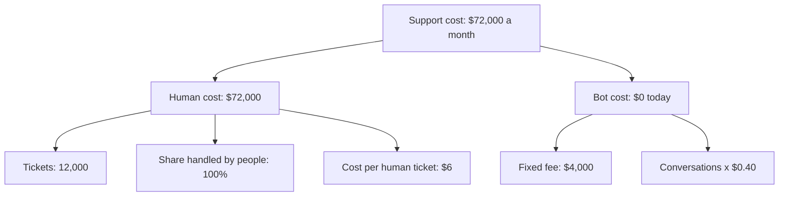
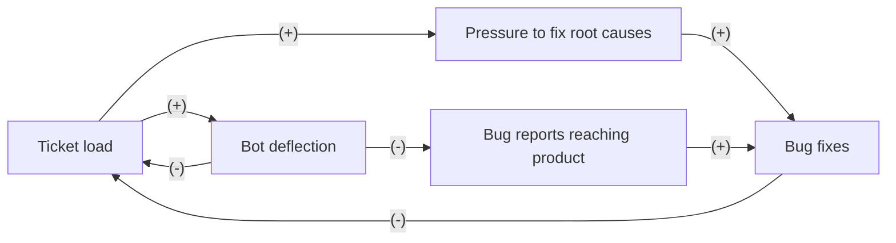

# Case: A chatbot to deflect support tickets

## The situation

Tallyport is a fictional invoicing app for small businesses.

* Support gets 12,000 tickets a month. Each costs $6 to handle by a person: $72,000 a month.
* 40% of tickets are how-to questions (4,800 a month). The rest are errors, sync failures and billing problems.
* A chatbot vendor charges $4,000 a month plus $0.40 per conversation.
* Support files about 40 bug reports a month to the product team, from ticket themes.
* Support wants the chatbot in front of all tickets, to deflect as many as it can.

**Your task:** name the need and the input that decides the call, place the decision in a Cynefin domain, say who leads, and make one call: Go, Go with guardrails, Redesign, Don't, or Get X first. Show your reasoning: a number or two for the direct effect, and at least one loop.

<!-- solution: do not show before the user answers -->

# Tradeoff card: A chatbot to deflect support tickets

* **The call:** Go with guardrails: a bot for how-to questions only, with bug-shaped tickets kept with people and a holdout, not a bot in front of everything.
* **The need:** "to deflect as many as it can" (support), to cut a $72,000 monthly support bill.
* **Domain:** Complex (Cynefin): the product team reacts to what support tells it, customers adapt to the bot, the bug loop feeds back over quarters, and the cost of unfixed bugs lands after a 4-week test.
* **Who leads:** Systems thinker because the reactors, feedback with delay and time horizon tests point to the bug loop, which a deflection test cannot see. The Reductionist sizes the probe and its thresholds.
* **Deciding input:** the share of tickets the bot deflects. Assumed: 15% to 45%. It pays for itself above 12.2% across all tickets, or 24% on how-to questions only.
* **Assumption share:** 1 of 4 inputs assumed (tickets, cost per ticket and the vendor price are given). The money holds across the range, so the call turns on the loop: bug reports that stop reaching the product team.
* **What we give up:** the full-rollout saving of up to $23,600 a month in the high case, for a probe that saves about $6,000 a month while the bug loop is checked.
* **Revisit when:** the end of quarter 2, or at once if bug reports from support fall below 40 a month or repeat contacts within 7 days pass 10%.

## Reductionism (zoom in)

**Metric tree**

* **Lever:** the share handled by people goes down through deflection, while bot cost goes up.
* **Numbers:** support cost = tickets x share handled by people x $6 + bot cost. With the bot in front of all 12,000 tickets, bot cost = $4,000 + 12,000 x $0.40 = $8,800.
  * Low (15% deflected): 12,000 x 85% x $6 = $61,200; plus $8,800 = $70,000, a saving of $2,000.
  * Base (30% deflected): 12,000 x 70% x $6 = $50,400; plus $8,800 = $59,200, a saving of $12,800.
  * High (45% deflected): 12,000 x 55% x $6 = $39,600; plus $8,800 = $48,400, a saving of $23,600.
* **Break-even:** $8,800 / $6 = 1,467 tickets deflected, 12.2% of 12,000.
* **Test:** deflection = bot conversations with no human ticket within 7 days. 50/50 split of incoming contacts for 4 weeks, about 6,000 per arm. Success: 20% or more deflected, with repeat contacts within 7 days at 10% or less.

## Systems thinking (zoom out)

**Loop map**

| Loop | Type | Links | Delay | Who reacts and why | Signal to watch |
|---|---|---|---|---|---|
| B1 Symptom fix | B | Ticket load -> Bot deflection (+), Bot deflection -> Ticket load (-) | Days | Support lead: the queue grows, so more topics go to the bot | Human tickets per week |
| B2 Root cause fix | B | Ticket load -> Pressure to fix root causes (+), Pressure to fix root causes -> Bug fixes (+), Bug fixes -> Ticket load (-) | 1 to 2 quarters | Product team: ticket themes in weekly triage push bugs onto the roadmap | Tickets per 1,000 active accounts for the top 10 bug themes, monthly |
| R1 Hidden bugs | R | Ticket load -> Bot deflection (+), Bot deflection -> Bug reports reaching product (-), Bug reports reaching product -> Bug fixes (+), Bug fixes -> Ticket load (-) | 1 to 2 quarters | Product team: the bot absorbs the complaints, fewer bug themes reach triage, and fixes slip | Bug reports filed from support each month (baseline 40) |

* **Archetype:** shifting the burden. B1 is the symptomatic fix, B2 the fundamental fix, and R1 the side effect: the bot hides the signal that drives the fundamental fix, so the product bugs never get fixed.
* **Second-order effects:** customers with a real error who hit the bot twice may churn instead of asking a third time. People in support keep only the hard tickets, so the cost per human ticket rises above $6.

## The clash

| From | Challenge | Reply |
|---|---|---|
| Reductionist to Systems thinker | The bot saves $12,800 a month in the base case. What does the bug loop cost in dollars? | Not known yet; it shows as tickets per 1,000 accounts that stop falling. Keep bug-shaped tickets with people and the loop never starts. |
| Systems thinker to Reductionist | Your $6 per ticket is an average. If the bot takes the easy tickets, does a human ticket still cost $6? | No, it rises, which shrinks the saving. So size the probe on how-to tickets only, where the break-even is clear. |

## The call

* **Decision:** Go with guardrails. The bot answers how-to questions only; errors, sync failures and billing problems always go to a person.
* **Probe size (Reductionist):** 80% of the 4,800 how-to contacts a month, 3,840 conversations. Bot cost: $4,000 + 3,840 x $0.40 = $5,536. Break-even: $5,536 / $6 = 923 deflected, 24% of 3,840. Success: 30% or more deflected. At 50% it saves 1,920 x $6 = $11,520, minus $5,536 = $5,984 a month.
* **Guardrails:** every bot conversation is tagged by theme and goes into weekly product triage. Stop expanding if bug reports from support fall below 40 a month, or if repeat contacts within 7 days pass 10%.
* **Holdout:** 20% of how-to contacts never see the bot, for two quarters.
* **Revisit trigger:** the end of quarter 2. Tickets per 1,000 active accounts must be falling, or the bot stays limited to how-to questions.
* **What would change the call:** bug-theme tickets per 1,000 accounts falling while the bot runs would allow more topics. Bug reports from support falling makes it Redesign: send a summary of every bot conversation to triage.

## Assumptions to check

1. The cost per human ticket stays near $6 when the easy tickets leave. Check cost per ticket by topic.
2. How-to questions do not hide bugs. Check a sample of 200 how-to tickets for errors behind them.
3. Customers accept a bot for how-to questions. Check satisfaction scores for bot conversations against the holdout.
