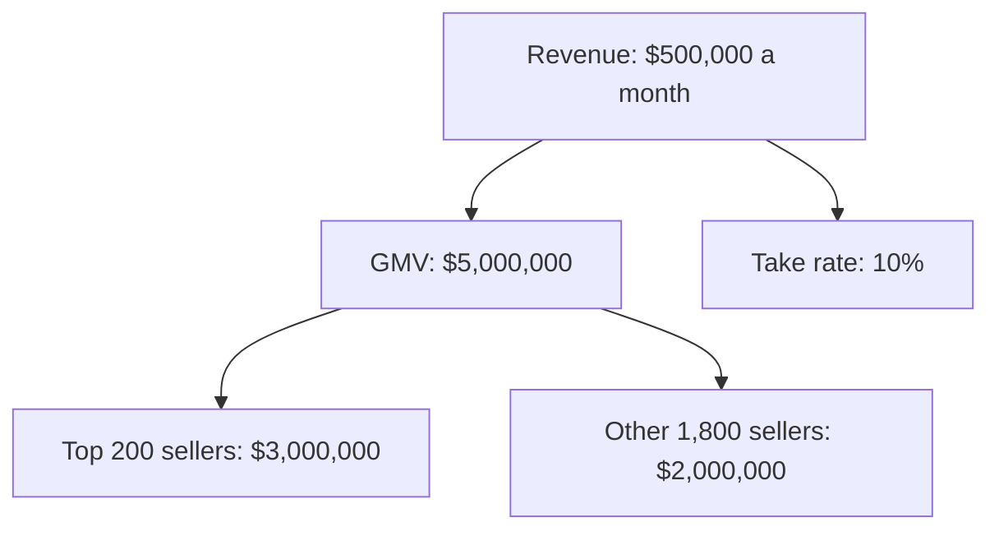
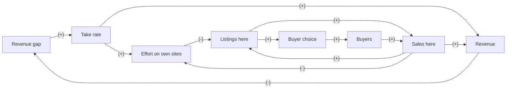

# Case: raise the marketplace take rate

## The situation

Kilnyard is a fictional marketplace for handmade ceramics. It keeps a 10% take rate on every sale.

* 2,000 active sellers sell $5,000,000 a month (GMV), so revenue is $500,000 a month.
* The top 200 sellers make 60% of GMV, $3,000,000, about $15,000 each. The other 1,800 make $2,000,000, about $1,100 each.
* Many top sellers also sell on their own websites and on one other marketplace. Most smaller sellers sell only here.
* 3% of sellers stop selling each month.
* Finance wants to raise the take rate from 10% to 12%.

**Your task:** place the decision in a Cynefin domain, say who leads, and make one call: Go, Go with guardrails, Redesign, or Don't. Show your reasoning: a number or two for the direct effect, and at least one loop.

<!-- solution: do not show before the user answers -->

# Tradeoff card: raise the marketplace take rate

* **The call:** Redesign: a tiered rate, 12% on each seller's first $2,000 of monthly sales and 10% above that, instead of a flat 12%.
* **Domain:** Complex (Cynefin): top sellers have other places to sell and react to the fee, buyers follow the choice of pieces, and the loss shows up months after revenue goes up.
* **Who leads:** Systems thinker because the reactors, feedback with delay and shared things tests point to effects a revenue forecast cannot see. The Reductionist sizes the tiers and the probe.
* **What we give up:** about $52,000 a month against a flat 12% if GMV held ($100,000 against $48,000).
* **Revisit when:** the 12-week probe ends, or at once if top sellers' GMV in the probe categories falls 5% or more against the other categories.

## Reductionism (zoom in)

**Metric tree**

* **Lever:** the take rate, from 10% to 12%.
* **Numbers:** revenue = GMV x take rate.
  * Today: $5,000,000 x 10% = $500,000.
  * GMV holds: $5,000,000 x 12% = $600,000, a gain of $100,000.
  * Low (GMV falls 15%): $4,250,000 x 12% = $510,000, a gain of $10,000.
  * Base (GMV falls 8%): $4,600,000 x 12% = $552,000, a gain of $52,000.
  * High (GMV falls 3%): $4,850,000 x 12% = $582,000, a gain of $82,000.
* **Break-even:** revenue stays at $500,000 as long as GMV falls less than 16.7%: $500,000 / 12% = $4,166,667, which is 83.3% of $5,000,000.
* **Test:** a take rate is hard to A/B test, because sellers talk to each other. The cleanest read is two categories that make 20% of GMV at the new rate for 12 weeks, against the other categories and the same weeks last year.

## Systems thinking (zoom out)

**Loop map**

| Loop | Type | Links | Delay | Who reacts and why | Signal to watch |
|---|---|---|---|---|---|
| B1 Revenue fix | B | Revenue gap -> Take rate (+), Take rate -> Revenue (+), Revenue -> Revenue gap (-) | 1 month | Finance: the higher rate shows up in the first billing cycle | Revenue per dollar of GMV, monthly |
| R1 Fee backfires | R | Revenue gap -> Take rate (+), Take rate -> Effort on own sites (+), Effort on own sites -> Listings here (-), Listings here -> Sales here (+), Sales here -> Revenue (+), Revenue -> Revenue gap (-) | 3 to 9 months | Top sellers: at 12%, their own sites and the other marketplace pay better, so their new pieces go there first | Share of top sellers' new pieces listed here first, monthly |
| R2 Channel shift | R | Effort on own sites -> Listings here (-), Listings here -> Sales here (+), Sales here -> Effort on own sites (-) | 3 to 12 months | Top sellers: the channel that sells more gets more of their time, so a small shift away keeps growing | Top sellers' GMV here, against the same months last year |
| R3 Thinner choice | R | Listings here -> Buyer choice (+), Buyer choice -> Buyers (+), Buyers -> Sales here (+), Sales here -> Listings here (+) | 6 to 12 months | Buyers: fewer standout pieces give them fewer reasons to browse here, so every seller sells less | Buyer visits and repeat purchase rate, monthly |

* **Archetype:** success to the successful (R2). Two channels compete for the same sellers' time and pieces, and whichever pulls ahead gets more. R1 is fixes that fail: the fee that closes the revenue gap erodes the sales it is charged on.
* **Second-order effects:** sellers who stay may raise prices to cover the fee, which buyers pay. A flat raise also hands the other marketplace a sales pitch to top sellers.

## The clash

| From | Challenge | Reply |
|---|---|---|
| Reductionist to Systems thinker | GMV can fall 16.7% before a flat 12% loses money. Can top sellers really move that much? | They do not need to move far: 200 sellers make 60% of GMV, so a quarter of them moving their sales elsewhere takes 50 x $15,000 = $750,000, 15% of GMV, and buyers follow the choice. |
| Systems thinker to Reductionist | Your break-even treats every lost dollar of GMV the same. Is a top seller's dollar worth more? | Yes. Top sellers' pieces bring the buyers who also buy from small sellers, so the probe tracks buyer visits, not only GMV. |

## The call

* **Decision:** Redesign. A tiered rate: 12% on each seller's first $2,000 of monthly sales, 10% above that. If GMV holds, revenue rises $48,000 a month: 200 top sellers x 2% x $2,000 = $8,000, plus 2% x $2,000,000 = $40,000 from the other 1,800. A top seller at $15,000 a month pays (12% x $2,000 + 10% x $13,000) / $15,000 = 10.3% instead of 10%.
* **Probe size (Reductionist):** two categories that make 20% of GMV, $1,000,000 a month, for 12 weeks. If their GMV holds, revenue there rises 9.6%, about $9,600 a month on their $100,000.
* **Guardrails:** stop if top sellers' GMV in the probe categories falls 5% or more against the other categories, or if the share of their new pieces listed here first drops 10 points.
* **Holdout:** every other category stays at 10% during the probe.
* **Revisit trigger:** the end of week 12, or any guardrail breach.
* **What would change the call:** smaller sellers leaving at 5% a month or more, 2 points above today's 3%, makes it Don't. Top sellers' GMV holding for 6 months makes it worth testing 11% above $2,000.

## Assumptions to check

1. Sellers under $2,000 a month have fewer other places to sell than top sellers. Check how many link to their own shop or another marketplace.
2. The 1,800 smaller sellers each sell under $2,000 a month. Check the distribution: some will be above it.
3. The probe categories behave like the rest. Check their seasonality against last year.
4. Sellers do not pass the fee on in their prices. Check average prices in the probe categories.
